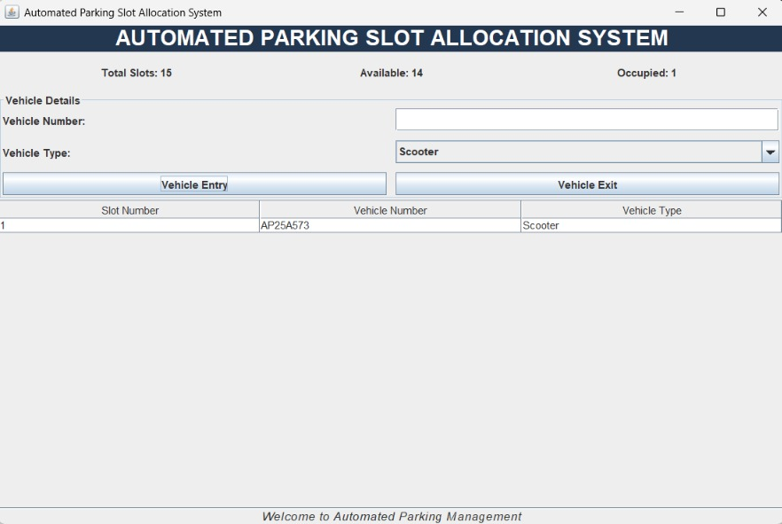
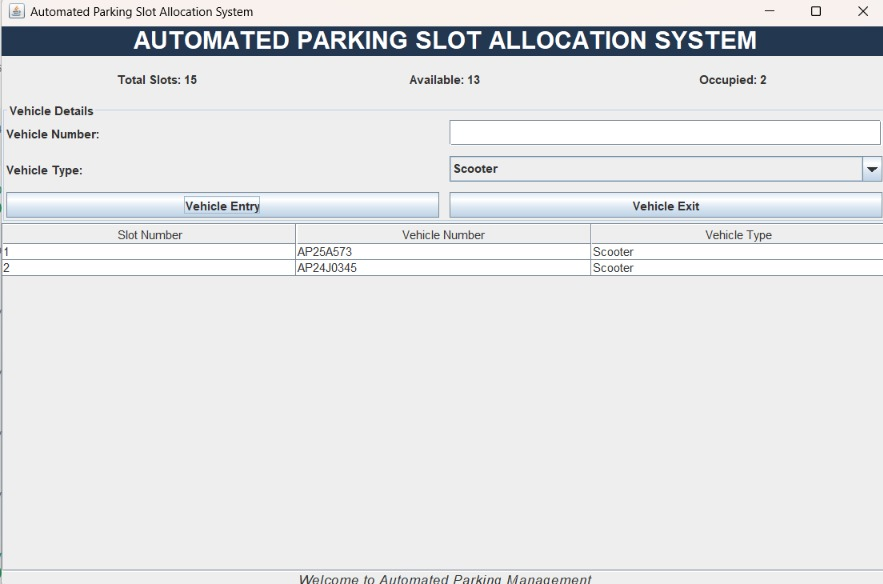
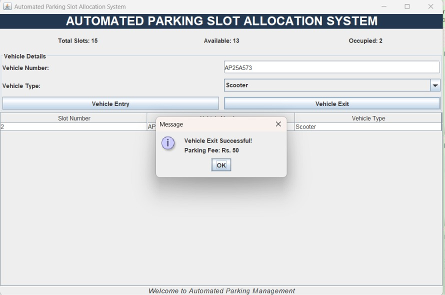

🚗 AUTOMATED PARKING SLOT ALLOCATION SYSTEM

1. Project Title

Automated Parking Slot Allocation System

A Java-based desktop application designed to simplify vehicle parking management through automatic slot allocation and an easy-to-use graphical interface.

---

2. Project Description

The Automated Parking Slot Allocation System is a desktop-based application developed using Core Java and Java Swing to manage parking spaces in an organized and efficient manner.

In many parking areas, managing vehicles and finding available parking spaces manually can be difficult and time-consuming. This project provides a computerized solution to reduce manual work and improve parking management.

The system allows users to enter vehicle details, allocate available parking slots, monitor occupied and vacant spaces, and manage vehicle parking information.

It also supports different vehicle categories, such as cars, scooters and vans, making parking management more convenient.

The main purpose of this project is to save time, reduce confusion, improve slot utilization and provide a simple parking management experience.

---

3. Technologies Used

The following technologies are used to develop this application:

3.1 Core Java

- Used to develop the main application logic.
- Handles vehicle information and parking operations.
- Performs parking slot allocation.
- Calculates parking charges.

3.2 Java Swing

- Used to develop the Graphical User Interface (GUI).
- Provides buttons, text fields, tables and panels.
- Makes the application interactive and user-friendly.

3.3 Visual Studio Code

- Used as the development environment.
- Helps write, edit, compile and execute Java programs.

---

4. Features of the Project

The application provides the following important features:

4.1 Automatic Parking Slot Allocation

Automatically assigns an available parking slot to an incoming vehicle.

4.2 Parking Slot Availability

Displays the total number of parking slots and indicates which slots are available or occupied.

4.3 Multiple Vehicle Support

Supports different types of vehicles:

- Cars
- Scooters
- Vans
- Truks

4.4 Vehicle Information Management

Allows users to enter and manage vehicle details, such as:

- Vehicle number
- Vehicle type
- Parking slot number

4.5 Parking Fee Calculation

Calculates parking charges based on the applicable parking duration and fee structure.

4.6 Vehicle Entry and Exit Management

Helps manage vehicle parking entry and exit operations.

4.7 User-Friendly Interface

Provides a simple graphical interface that makes it easy to operate the application without using complex commands.

4.8 Parking Information Display

Displays parking details in an organized manner, helping users monitor parking activities.

---

5. How to Run the Project

Follow these steps to execute the application:

Step 1: Install Java JDK

Download and install the Java Development Kit (JDK) on your computer.

Step 2: Install Visual Studio Code

Install Visual Studio Code to write and execute the Java program.

Step 3: Install Java Extension Pack

Open VS Code Extensions and install the Java Extension Pack.

Step 4: Open the Project

Open Visual Studio Code and select the project folder.

Step 5: Open the Main Java File

Open the main Java source file of the application.

Step 6: Execute the Program

Click the Run button in VS Code to compile and execute the Java application.

---

6. Screenshot of the Application

The following screenshots demonstrate the working of the Automated Parking Slot Allocation System.

6.1 Main Application Dashboard

6.2  Vehicle Entry and Slot

6.3 Parking Information

6.4 Parking Fee Calculation

---

7. Advantages of the Project

- Reduces manual parking management work.
- Saves time during vehicle parking.
- Makes parking slot identification easier.
- Provides organized vehicle information.
- Improves parking space utilization.
- Offers a simple and convenient user interface.

---

8. Future Enhancements

The project can be improved in the future by adding:

- Online parking slot booking.
- Digital payment integration.
- QR code-based vehicle entry.
- Real-time parking availability updates.
- Admin login and authentication.
- Mobile application integration.

---

9. Conclusion

The Automated Parking Slot Allocation System provides a simple and efficient solution for managing parking spaces.

By using Core Java and Java Swing, the application offers an interactive platform for vehicle entry, parking slot allocation, availability monitoring and parking fee calculation.

This project demonstrates how Java programming concepts can be used to develop a practical real-world application.

---

👨‍💻 Project Developed Using

Core Java 
Java Swing 

